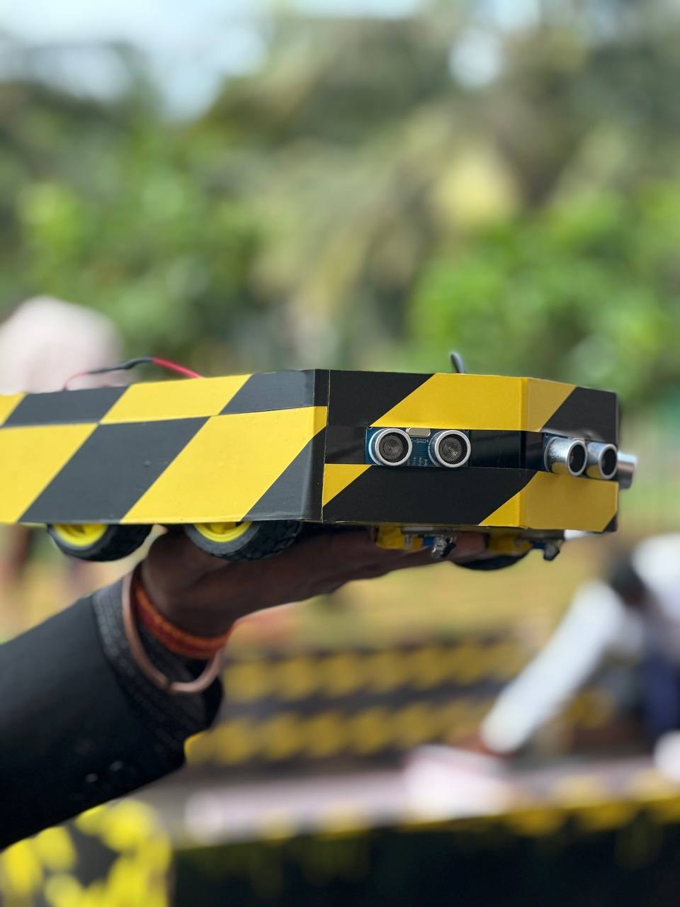
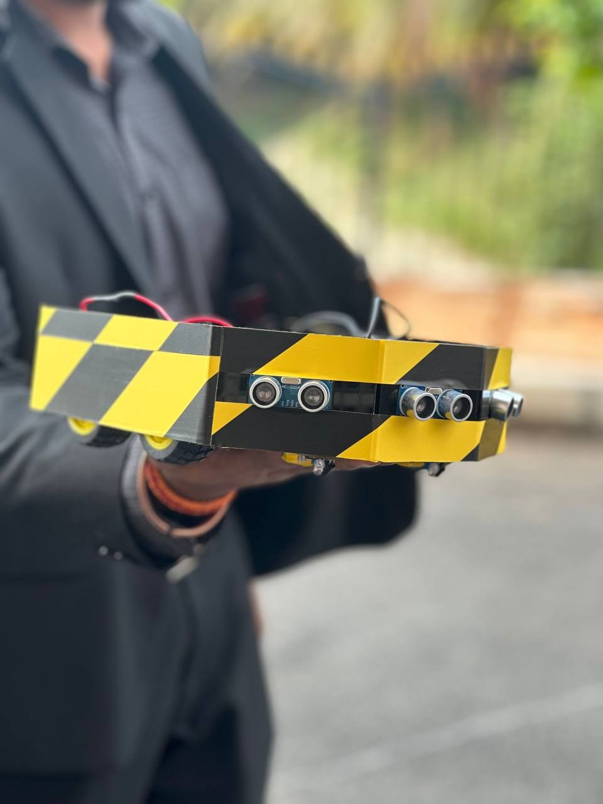

# Line-Following and Obstacle-Avoidance Robot

An Arduino Uno mobile robot combining **IR-based line sensing** with **ultrasonic obstacle detection**. The project used **three HC-SR04 ultrasonic sensors**, IR sensors and an Adafruit motor driver. Both line following and obstacle avoidance worked on the physical robot.

## My contribution — Semester 5

I worked on coding and the electrical connections for line following and obstacle avoidance. Both functions worked separately and together.

## How it works

The IR sensors provide information about the track beneath the robot, allowing the controller to adjust wheel movement to follow the line. The ultrasonic sensors provide distance measurements for detecting nearby obstacles. The Arduino Uno processes these inputs and commands the motors through the Adafruit driver.

## Hardware

| Component | Details |
| --- | --- |
| Controller | Arduino Uno |
| Distance sensors | Three HC-SR04 ultrasonic sensors |
| Track sensors | IR sensors |
| Motor control | Adafruit motor driver; revision not specified |

## Demonstrated functions

- Line following worked on the robot.
- Obstacle avoidance worked on the robot.
- Both functions were reported to work separately and together.

The exact mode-switching logic is not documented. No editable original program was included in the project files.

## Demonstration

[Watch the floor-track demonstration](media/videos/img-9979.mp4)

